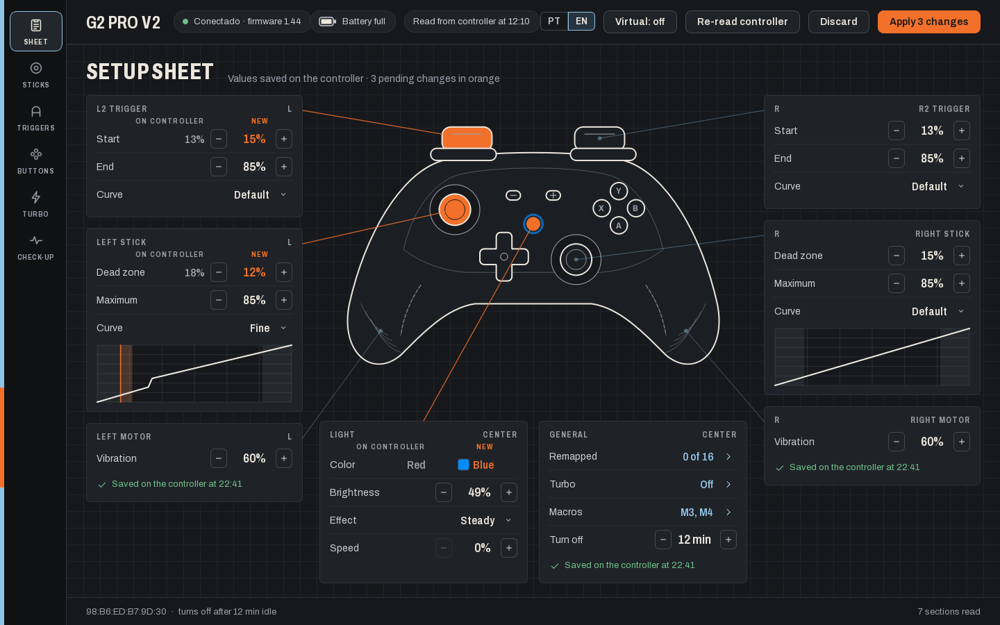
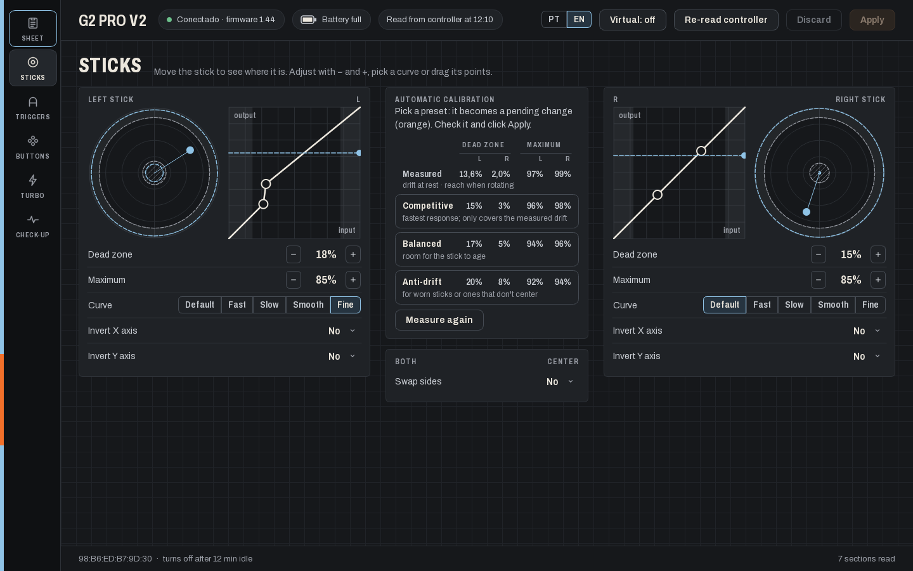
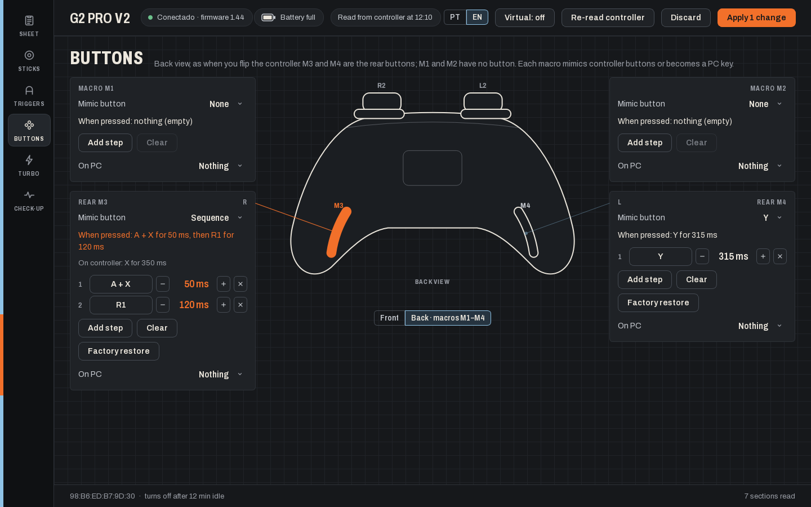

# G2 Pro V2 — Setup sheet

**English** · [Português](README.pt-BR.md)

Configure your **Machenike G2 Pro V2** controller on Windows, no phone needed. Sticks, triggers, buttons, turbo,
lighting, macros, and rear buttons that become PC keys. Unofficial.



## Download and run

1. Download **`G2ProV2.exe`** from the [latest release](../../releases/latest).
2. Open it. No installation needed.
3. Turn on the controller (USB cable, 2.4G dongle or Bluetooth). The sheet fills in by itself.

You need Windows 10 or 11 with **Bluetooth turned on**, since that is how the app configures the controller, even
when you play over cable or dongle. The app is in English or Portuguese: use the **PT | EN** switch in the top bar.

## What you can do

| | |
|---|---|
| **Setup sheet** | See everything at a glance around a drawing of the controller. Change values with − / +; changes stay orange until you click **Apply**, and the app only says "Saved" after reading the controller back. |
| **Sticks** | Dead zone, maximum, curve and axis inversion, with the live stick. **Automatic calibration** measures drift and reach and suggests Competitive, Balanced or Anti-drift. |
| **Triggers** | Start and end of travel and the curve of L2/R2. |
| **Buttons** | Remap or disable each button, and set up macros M1–M4 in the back view. |
| **Turbo** | Manual or automatic per button, with the speed in Hz. |
| **Check-up** | Live inputs, vibration test, battery and controller calibration. |



## Rear buttons as PC keys



In **Buttons › Back**, each macro (M1–M4) can mimic controller buttons or become a PC key. Pick an option under
**On PC**:

- **Shortcut:** F5, Ctrl+S, any key or combination.
- **Special key:** F13 to F24. No keyboard has these keys, so you can bind them to anything in a game without
  conflicts.
- **Text:** types a text.
- **Sequence:** a small PC macro, for example `Ctrl+C, 100 ms, Ctrl+V, "gg", Enter, click`.

Click **Apply** and press the rear button. The app has to be open for this, but it can be minimized.

**Virtual controller (optional):** the rear button signals a quick tap of L3 + R3, which the game also sees. Turn on
**Virtual** in the top bar and the game gets a clean virtual Xbox controller instead, with vibration, while the rear
buttons only send their keys. This needs two free drivers by Nefarius, installed once:
[ViGEmBus](https://github.com/nefarius/ViGEmBus/releases) and [HidHide](https://github.com/nefarius/HidHide/releases)
(restart the PC after HidHide).

## Common questions

**Why does it need Bluetooth if I play over cable?**
Over cable or dongle, Windows only sees an Xbox 360 controller, with no way to change settings. The settings channel
is Bluetooth, and it works at the same time as the cable or dongle.

**Can it break my controller?**
The app only writes settings that were tested on the real controller, and it reads them back after every change. It
does not do factory resets or firmware updates; use the official app for those.

**Why can't the rear buttons send keys without the app?**
The controller's firmware only accepts controller buttons in macros, and it doesn't present itself to Windows as a
keyboard. The app is what turns the rear button's signal into a key.

**Can I still use the KeyLinker app?**
Yes. Just don't keep both connected at the same time.

## Why this exists

The G2 Pro V2 could only be configured with KeyLinker, a phone app; Machenike's PC software doesn't support this
model. This app was built by reverse engineering KeyLinker's Bluetooth protocol and checking it on the real
controller, command by command. The details are in [docs/PROTOCOLO.md](docs/PROTOCOLO.md) (Portuguese).

<details>
<summary><b>For developers</b></summary>

Python 3.12 or newer:

```
pip install -r requirements.txt
python app.py            # run the app
python app.py selftest   # calibration, macro and translation checks
python keylinker.py      # protocol self-test ("scan" and "dump" read the controller)
```

Build the executable (only after changing the code):

```
pip install pyinstaller
python -m PyInstaller --noconfirm --distpath . G2ProV2.spec
```

| File | What it is |
|---|---|
| `app.py` | The app (PySide6). |
| `i18n.py` | English translations; every visible text goes through `tr("Portuguese text")`. |
| `keylinker.py` | The controller protocol: packets, reads, writes and a self-test with real packets. |
| `assets/` | Archivo font, icons and the app icon. |
| `docs/` | The protocol and the README screenshots. |

</details>

## Credits

- **Archivo** font by Omnibus-Type (SIL OFL): `assets/fonts/OFL.txt`.
- **ViGEmBus** and **HidHide** by Nefarius Software Solutions.
- KeyLinker and the G2 Pro V2 belong to Machenike. This project is not affiliated with Machenike; the reverse
  engineering was done for interoperability with the controller.
