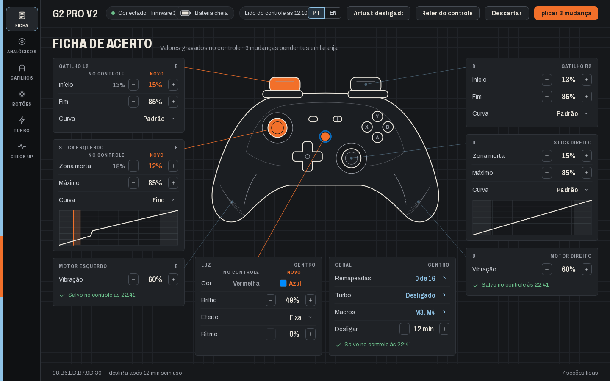
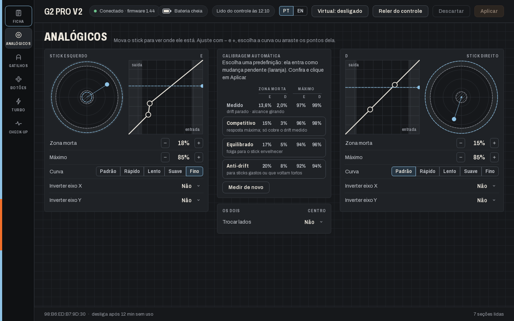
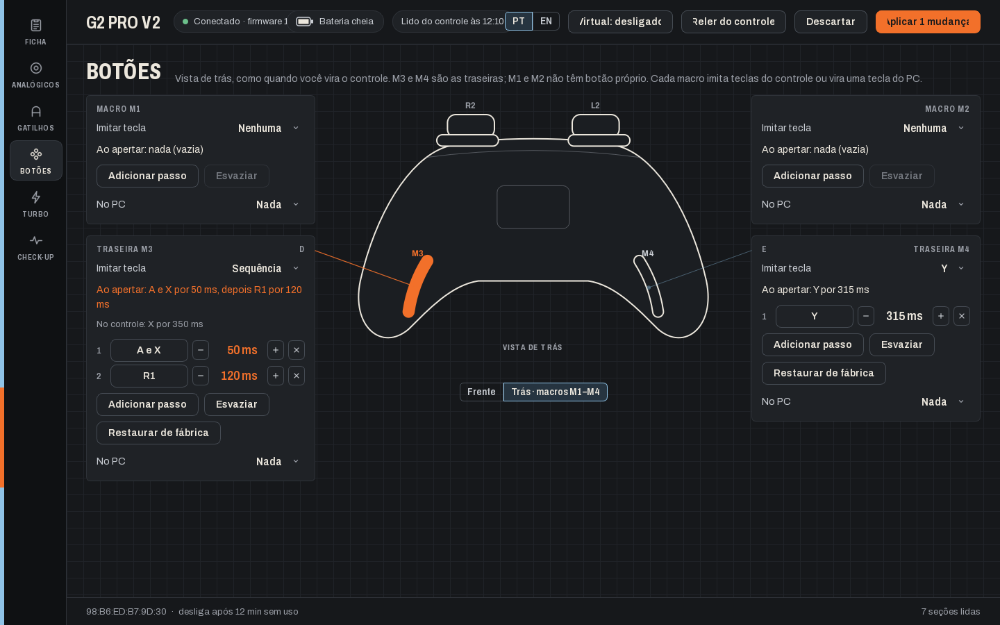

# G2 Pro V2 — Ficha de acerto

[English](README.md) · **Português**

Configure o controle **Machenike G2 Pro V2** no Windows, sem precisar do celular. Analógicos, gatilhos, botões,
turbo, luz, macros e traseiras que viram teclas do PC. Não oficial.



## Baixar e usar

1. Baixe o **[G2ProV2.exe](https://github.com/Kozato01/Machenike-G2-Pro-V2-PC/releases/latest/download/G2ProV2.exe)**.
2. Abra. Não precisa instalar.
3. Ligue o controle (cabo USB, dongle 2.4G ou Bluetooth). A ficha se preenche sozinha.

Você precisa de Windows 10 ou 11 com o **Bluetooth ligado**, porque é por ele que o app configura o controle, mesmo
quando você joga pelo cabo ou pelo dongle. O app está em português ou inglês: use o seletor **PT | EN** na barra de
cima.

## O que dá para fazer

| | |
|---|---|
| **Ficha** | Tudo num relance, em volta de um desenho do controle. Mude com − / +; o que mudou fica laranja até você clicar em **Aplicar**, e o app só diz "Salvo" depois de reler o controle. |
| **Analógicos** | Zona morta, máximo, curva e inversão de eixos, com o stick ao vivo. **Calibragem automática**: mede o drift e o alcance e sugere Competitivo, Equilibrado ou Anti-drift. |
| **Gatilhos** | Início e fim do curso e curva de L2/R2. |
| **Botões** | Remapear ou desativar cada tecla, e configurar as macros M1–M4 na vista de trás. |
| **Turbo** | Manual ou automático por tecla, com a velocidade em Hz. |
| **Check-up** | Entradas ao vivo, teste de vibração, bateria e calibração do controle. |



## Traseiras como teclas do PC



Em **Botões › Trás**, cada macro (M1–M4) pode imitar teclas do controle ou virar uma tecla do PC. Escolha em
**No PC**:

- **Atalho:** F5, Ctrl+S, qualquer tecla ou combinação.
- **Tecla especial:** F13 a F24. Nenhum teclado tem essas teclas, então dá para ligá-las a qualquer comando no jogo
  sem conflito.
- **Texto:** digita um texto.
- **Sequência:** uma pequena macro de PC, por exemplo `Ctrl+C, 100 ms, Ctrl+V, "gg", Enter, clique`.

Clique em **Aplicar** e aperte a traseira. O app precisa estar aberto para isso, mas pode ficar minimizado.

**Controle virtual (opcional):** a traseira sinaliza com um toque rápido de L3 + R3, que o jogo também vê. Ligue o
**Virtual** na barra de cima e o jogo passa a receber um controle Xbox virtual limpo, com vibração, enquanto as
traseiras só mandam as teclas. Isso precisa de dois drivers gratuitos do Windows, da Nefarius (ViGEmBus e
HidHide). O app traz os instaladores: na primeira vez que você liga o **Virtual**, ele oferece instalar, e depois é
só reiniciar o PC uma vez.

## Dúvidas comuns

**Por que precisa de Bluetooth se eu jogo pelo cabo?**
Pelo cabo ou pelo dongle, o Windows só enxerga um controle de Xbox 360, sem como mudar configurações. O canal de
configuração é o Bluetooth, e ele funciona ao mesmo tempo que o cabo ou o dongle.

**Isso pode estragar meu controle?**
O app só grava configurações que foram testadas no controle real, e relê o controle depois de cada mudança. Ele não
faz restauração de fábrica nem atualização de firmware; para isso, use o app oficial.

**Por que as traseiras não mandam teclas sem o app?**
O firmware do controle só aceita teclas de controle nas macros, e ele não se apresenta ao Windows como teclado. É o
app que transforma o sinal da traseira em tecla.

**Ainda posso usar o KeyLinker?**
Sim. Só não deixe os dois conectados ao mesmo tempo.

## Por que este app existe

O G2 Pro V2 só se configurava pelo KeyLinker, um app de celular; o programa de PC da Machenike não suporta este
modelo. Este app nasceu da engenharia reversa do protocolo Bluetooth do KeyLinker, conferido no controle real,
comando a comando. Os detalhes estão em [docs/PROTOCOLO.md](docs/PROTOCOLO.md).

<details>
<summary><b>Para desenvolvedores</b></summary>

Python 3.12 ou mais novo:

```
pip install -r requirements.txt
python app.py            # abre o app
python app.py selftest   # confere calibragem, macros e traduções
python keylinker.py      # autoteste do protocolo ("scan" e "dump" leem o controle)
```

Gerar o executável (só depois de mudar o código):

```
pip install pyinstaller
python -m PyInstaller --noconfirm --distpath . G2ProV2.spec
```

| Arquivo | O que é |
|---|---|
| `app.py` | O app (PySide6). |
| `i18n.py` | Traduções para o inglês; todo texto visível passa por `tr("texto em português")`. |
| `keylinker.py` | O protocolo do controle: pacotes, leituras, gravações e autoteste com pacotes reais. |
| `assets/` | Fonte Archivo, ícones e o ícone do app. |
| `docs/` | O protocolo e os prints do README. |

</details>

## Créditos

- Fonte **Archivo**, da Omnibus-Type (SIL OFL): `assets/fonts/OFL.txt`.
- **ViGEmBus** (BSD-3-Clause) e **HidHide** (MIT), da Nefarius Software Solutions; os instaladores vêm com o app,
  com as licenças em `assets/drivers/`.
- KeyLinker e o G2 Pro V2 são da Machenike. Este projeto não tem ligação com a Machenike; a engenharia reversa foi
  feita para interoperabilidade com o controle.
